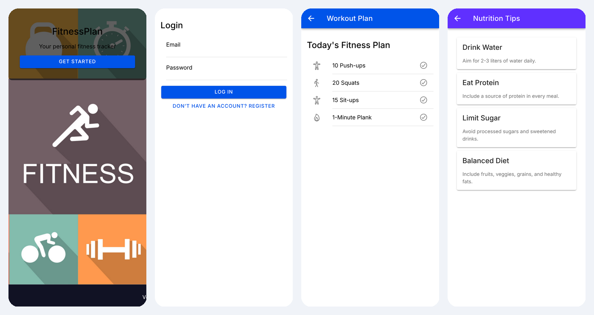

# FitnessPlan – Mobile Fitness App

A cross-platform mobile app for daily workouts and nutrition tips, built with **Ionic React**, **TypeScript** and **Firebase Authentication**.
Users create an account, sign in, and get a simple daily workout plan and healthy-eating tips.



## Features

- **Sign up and log in** with email and password (Firebase Authentication)
- **Protected routes**: the home screen is only reachable when signed in (custom `PrivateRoute`)
- **Splash screen** with a call to action
- **Workout plan**: today's exercises in a native-style list
- **Nutrition tips** shown as cards
- **Log out**, which returns the user to the login screen
- Follows the device's light/dark mode (Ionic system palette)

## Tech stack

| Area | Tools |
|---|---|
| UI | Ionic React 8, React 19, Ionicons |
| Language | TypeScript |
| Auth | Firebase Authentication 11 |
| Native runtime | Capacitor 7 (iOS / Android ready) |
| Build | Vite |
| Testing setup | Vitest (unit), Cypress (e2e) |

## Getting started

```bash
git clone https://github.com/esafi23/FitnessPlan-MobileApp.git
cd FitnessPlan-MobileApp
npm install
npm run dev        # starts the app at http://localhost:5173
```

To use your own Firebase project, replace the config in `src/firebaseConfig.ts` and enable **Email/Password** sign-in in the Firebase console.

Other scripts:

```bash
npm run build      # type-check and production build
npm run test.unit  # unit tests (Vitest)
npm run test.e2e   # end-to-end tests (Cypress)
npm run lint
```

## Project structure

```
src/
├── App.tsx              # routes
├── PrivateRoute.tsx     # redirects to /login when not signed in
├── firebaseConfig.ts    # Firebase initialisation
└── pages/
    ├── SplashScreen.tsx
    ├── Login.tsx
    ├── Register.tsx
    ├── Home.tsx
    ├── Workout.tsx
    └── Nutrition.tsx
```

## Next steps

- Save each user's workouts and progress in Firestore
- Let users mark exercises as done and track streaks
- Build and publish Android/iOS versions with Capacitor

## Author

**Eshaq Safi**, Full-Stack Developer (frontend focus) · [GitHub](https://github.com/esafi23) · [LinkedIn](https://www.linkedin.com/in/eshaq-safi)
